<!-- Profile README for github.com/venmadhi/venmadhi -->

<div align="center">



</div>

<div align="center">

[](https://github.com/venmadhi)

**Frontend or full-stack engineer — the public internet**

Building useful things and sharing the work in public.

[GitHub](https://github.com/venmadhi) · [LinkedIn](https://linkedin.com/in/venmadhi_k) · [Email](mailto:kvenmadhi@gmail.com)

</div>

---

## Identity, with signal

> **LIVE SIGNAL** — 14 repos · 0 stars · 22 contributions · 0 followers

Full-stack developer with hands-on experience building AI-integrated platforms, RESTful APIs, and real-time web applications using React.js, Django, Spring Boot, and PostgreSQL. I like architecting solutions end-to-end — from database schema to responsive UI.

- 🎓 B.Tech Information Technology, SKCET Coimbatore (2023 – 2027) · CGPA 8.26
- 📍 Coimbatore, Tamil Nadu, India
- 🎯 Seeking a software developer role to contribute to production-grade challenges

**Focus:** `JavaScript` · `Python` · `TypeScript`

---

## What moves the work

**CURRENT FOCUS — Ideas taking shape**

| 01 | 02 | 03 |
|:--:|:--:|:--:|
| **JavaScript** | **Python** | **TypeScript** |
| current focus | in the build queue | in the build queue |

<sub>Positioning is useful when the proof is close behind it.</sub>

---

## The tools behind the signal

**TECHNOLOGY SPECTRUM — The tools behind the work**

<p>
  <br/>
  <br/>
  
</p>

<sub>JavaScript · Python · TypeScript · Java · CSS · HTML — chosen for the work, not the trend.</sub>

---

## Built, shipped, shared

**PROJECT CONSTELLATION — A universe of work**

### 🌾 Farm-Assist — *featured*

**An Explainable Multi-Agent AI Framework for Personalized and Profit-Oriented Agricultural Decision Support for Kerala Farmers**

`Python` · `Artificial Intelligence` · `Machine Learning` · `Computer Vision` · `NLP` · `Precision Agriculture`

AgriGenie AI is an advanced agricultural decision intelligence platform designed to replace generic, lookup-table farming suggestions with personalized, climate-resilient, explainable, and profitable actions.

It establishes a **Farmer Digital Twin** to track land history, soil health, and past yields, and orchestrates **5 specialized AI agents** to generate unified farming decisions.

🔗 [github.com/venmadhi/Farm-Assist](https://github.com/venmadhi/Farm-Assist)

### Other projects

| Project | Stack | Highlights | Repo |
|---|---|---|---|
| **Roammates** — Group travel planning | React.js · Tailwind CSS · Node.js · Express.js · MongoDB | Trips, itineraries, expense splitting, group polls, packing checklist, places wishlist; live weather (OpenWeatherMap) and currency (ExchangeRate) APIs | [Trip_Planner](https://github.com/venmadhi/Trip_Planner) |
| **LogisticsApp** — Courier & delivery management | React.js · Tailwind CSS · Google Maps API · Leaflet.js · Node.js | Live package tracking on an interactive map; WebSocket real-time delivery status updates | [Logistics](https://github.com/venmadhi/Logistics) |
| **Product Comparison App** — REST API web app | React.js · Spring Boot · Swagger · Postman | Documented REST APIs, server-side product matching, responsive feature and pricing comparison | [ProductComparision](https://github.com/venmadhi/ProductComparision) |

More repositories: [Blog-InkWell](https://github.com/venmadhi/Blog-InkWell) · [Ecommerce_Application](https://github.com/venmadhi/Ecommerce_Application) · [TaskManagement](https://github.com/venmadhi/TaskManagement)

**PROJECT LAUNCH SEQUENCE — Where the work went next**

```
01 / Nov 2026   Farm-Assist  ─────────  public work in motion
02 / 2025       Roammates · LogisticsApp
03 / 2024       Product Comparison App
```

---

## Momentum, made visible

**PROFILE SIGNAL**

<div align="center">


</div>

---

## The trail behind the work

**CONTRIBUTION ENERGY — Every day leaves a trace**

<div align="center">

[](https://github.com/venmadhi)

</div>

---

## Hackathons & participation

- VIT Empower Tech — Technical Expo, Vellore (March 2025)
- SAP Hackathon — College Round Participant (March 2025)
- Smart India Hackathon (SIH) — Internal Round, SKCET (Aug 2024 & 2025)

---

<div align="center">

## Make something worth noticing

*I like working with people who care about craft, context, and shipping the useful version.*

**OPEN CHANNEL — Build the next chapter**

[](https://github.com/venmadhi)
[](https://linkedin.com/in/venmadhi_k)
[](mailto:kvenmadhi@gmail.com)

<sub>Venmadhi · Wow Profile</sub>

</div>


